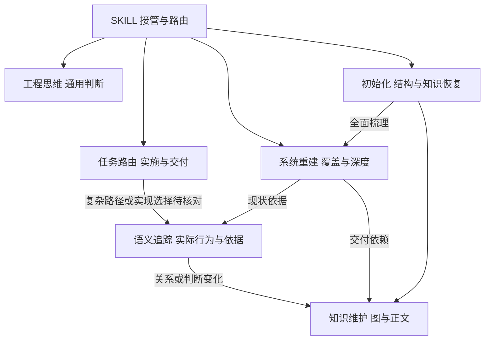
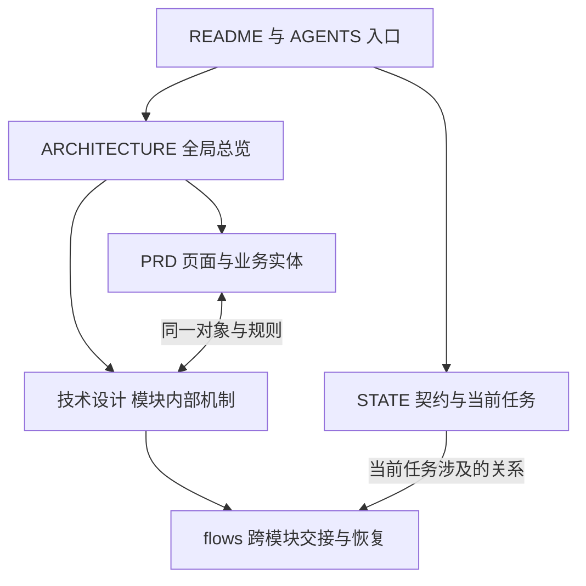
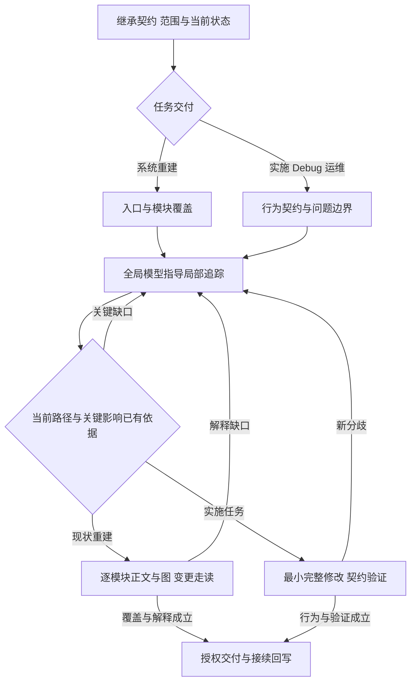

# Architecture Thinking

[](#codex)
[](#dsh)
[](LICENSE)

**让 Agent 解释系统怎样运行、判断应该改哪里，并在下一次会话接着做。**

> 做好依赖注入、渐进式加载、指令与知识分离、按任务路由、回写与归约，作者鼓励 AI native 时代的我们自我蒸馏。
> 这是一个轻量化的skill

`arch-thinking-skill` 为 **Codex 和 dsh（DeepSeek Harness）** 提供软件系统理解、实现与演进的方法。它把全局架构、局部代码语义、故障归因和工作区记忆连接起来：先继承设计与当前状态，沿真实路径形成判断，再完成修改、验证和交付，并把有复用价值的认识写回项目。

适用于新功能实施、系统接管、Debug、重构、PR 和运维。面对二十万行以上的遗留系统，重点恢复多套实现的实际选择、隐含契约、状态所有权与变更影响；面对已经批准的 PRD 和技术设计，重点沿既定契约把完整业务链路做好。

[核心亮点](#核心亮点) · [轻量化设计](#轻量化设计) · [方案对照](#与知名-skill-的设计对照) · [适用场景](#适用场景) · [安装与更新](#安装与更新) · [开始使用](#开始使用) · [方法导航](#渐进加载与职责) · [论文参考](#论文与工程实践参考)

## 核心亮点

**把代码读成系统，把证据变成判断，把一次任务留下的理解变成下一次工作的起点。**

| 工程中的真实困难 | Architecture Thinking 怎样处理 | 留下的能力 |
| --- | --- | --- |
| 同名实现散布多处，Agent 在相似代码间反复兜圈 | 由全局职责选择入口，沿注册、配置、调用和状态读写确认实际路径；局部发现回传系统图 | **全局理解 ↔ 局部追踪**：知道从哪里查，也知道证据会改变哪部分系统认识 |
| 复用旧逻辑牵动上下游，另写一套又增加状态与调用分支 | 从调用方、实现与消费者恢复隐含契约，比较复用、适配和独立责任的条件 | **有依据的复用与修改边界**：保留合法业务差异，修复覆盖必要责任 |
| 同一个错误结果，可能来自旧值提交、后续覆盖或副本读取 | 为竞争解释找预测分化的边界，追同一对象的身份、版本和交接，再选择修复位置 | **可区分的机制归因**：每次取证都服务下一项工程决定 |
| 测试通过，用户仍在另一条入口、配置或恢复路径遇到故障 | 先解释真实链路，再使验证对齐受影响模块、状态转换和用户行为 | **与架构同构的验证**：检查实际契约和关键交接 |
| 人类面对庞大代码库，评审依赖 Agent 的口头结论 | 图中标出实际实现、状态所有者、关键分支及证据入口；正文展开条件与后果 | **可追溯的决策视图**：人类能沿图检查依据、理解影响、选择方案 |
| 新会话反复读仓库，旧总结逐渐偏离当前实现 | 工作区保存系统解释与当前任务；新证据修订权威正文，并沿依赖更新图和入口 | **可更新的长期记忆**：接管后恢复当前判断及其依据 |
| 经验越积越多，关键区别在概括与压缩中逐渐模糊 | 合并重复解释，同时保留成立条件、因果机制和后继事件的处理区别 | **高保真归约**：精简后的知识仍能指导新的需求、故障与迁移 |

日常工具是 **rg／grep、源码、Git、普通 Markdown 和必要的运行观测**。完整判断方法见[工程思维](skills/arch-thinking-skill/assets/workspace/工程思维.md)。

## 轻量化设计

> 让方法各司其职，让知识随实践生长。

**以 Agent Infra 的视角组织 Skill：入口负责发现，路由负责选择，依赖负责组合，工作区负责记忆。** Markdown 提供可读、可编辑、可版本化的载体；方法之间的依赖、知识的归属和更新责任，让这些文件共同承担长期工作。

整段 Prompt 可以直接表达一组要求。随着任务与项目成长，规则、案例、历史结论和执行状态各有自己的适用范围与更新节奏。本 Skill 将这些职责显式拆开，使每次加载都有来由，每次修改都有归属。

| 设计机制 | 实现方式 | 对工程工作的价值 |
| --- | --- | --- |
| **显式依赖注入** | `SKILL.md` 声明任务需要的方法；项目入口绑定真实设计、架构和状态。Agent 沿这些依赖读取内容 | 通用方法与项目上下文在任务处组合，已有设计与当地规则持续生效 |
| **渐进式加载** | 先发现名称与描述，再读取入口，随后加载相关参考章节及源码 | 上下文围绕当前判断展开，细节保留按需下钻的位置 |
| **指令与知识分离** | 稳定指令规定工作方式；工程思维保存判断方法；项目正文保存带来源的系统事实与当前认识 | 方法可以跨项目复用，项目事实可以独立校正，规则变更有明确授权边界 |
| **按任务与理解缺口路由** | 实施、系统重建、Debug、迁移和交付各有操作策略；全局与局部之间随证据缺口切换 | 调查范围和文档深度服务实际任务，理解形成依据后进入行动 |
| **回写与归约** | 新证据修订对应权威正文，再沿依赖更新图与入口；合并时保留成立条件、因果机制和后继事件区别 | 当前知识保持可继承，积累的经验继续参与后续决策 |

依赖注入由宿主的 Skill 发现与 Agent 的显式读取共同完成。运行基础是现有 Agent、文件系统、Git 与命令工具，辅助脚本承担初始化和引用检查。**轻量体现在运行依赖、加载范围与维护成本；方法的深度来自可追踪的语义和证据。**

## 与知名 Skill 的设计对照

**复杂工程的难处，往往藏在流程步骤之间：依据什么定位、在哪里修改、怎样保留其他行为，以及下一次怎样继承这份理解。**

| 设计取向与代表 | 擅长解决的问题 | 在复杂工程中需要继续处理的痛点 | 本 Skill 的具体优势 |
| --- | --- | --- | --- |
| **开发流程编排** · [Superpowers](https://github.com/obra/superpowers#the-basic-workflow) | 串联需求讨论、计划、工作树、实现、评审和交付 | 已批准设计与历史实现交织时，每一步仍需要判断实际责任、复用条件与兼容边界 | **继承设计后直接进入契约差分。** 从真实实现找行为差距，按证据缺口切换全局与局部，边理解边交付 |
| **TDD 驱动开发** · [Superpowers](https://github.com/obra/superpowers#philosophy) | 通过失败测试、实现与重构形成反馈循环 | 遗留系统常有多套入口和隐含状态，测试本身的路径与断言也需要语义审查 | **语义追踪决定验证对象。** 先恢复触发条件和状态变化，再复用或补充能区分目标行为的检查 |
| **文件化任务规划** · [Planning with Files](https://github.com/OthmanAdi/planning-with-files#the-3-file-pattern) | 用计划、发现、进度文件及 hooks 保持任务连续性 | 任务记录提升为长期知识时，还需决定哪些结论持续成立、变化影响哪些判断、重复认识怎样合并 | **系统知识有归属，也有更新关系。** 保存架构、契约与判断前提，新写入者、新版本等变化触发对应回读与归约 |
| **独立能力集合** · [Anthropic Skills](https://github.com/anthropics/skills#about-this-repository) | 按需加载各领域的指令、脚本和资源，提供丰富的任务能力 | 多种能力共同参与一个长期工程时，还需连接设计、代码事实、当前状态和维护责任 | **在同一工程模型上组合方法。** 任务路由显式加载依赖，各方法共用项目知识入口，认识回到对应正文 |
| **整段 Prompt 集中组织规则与经验** | 直接表达角色、要求、步骤和案例 | 项目成长后，稳定规则与易变事实混放；加载范围扩大，历史结论与当前判断需要反复辨认 | **指令、方法、事实与状态分层维护。** 任务选择加载范围，事实保留证据，更新落到唯一职责位置 |

选择 Architecture Thinking，意味着把 **系统解释、工程决策和知识演进** 放进同一条工作链：任务完成时，留下可继续使用的系统理解；项目变化时，这份理解沿真实依赖继续修订。

## 在 AI Native 时代，自我蒸馏

> 愿每一次求解，都为下一次远行留下一盏灯。

作者鼓励每位使用者，把自己的工程判断蒸馏成能够反复使用的能力：抓住一次有效选择的转折，说明当时看见了什么、哪项证据改变了判断、采取行动需要哪些条件。让实践中的分辨力进入方法，让方法在下一次实践中接受校正。

具体项目的认识写回架构、模块或任务正文；具有迁移价值的经验，提炼成“触发条件 → 判断依据 → 行动选择 → 适用范围”，脱敏后进入相应方法。归约时从保留内容重新推出原来的判断，并用新的需求、故障或恢复情形检验其更新能力。已经明确的用户规则与设计承诺按原有权限维护。

**蒸馏的尺度，是经验还能指导多少真实选择。** 欢迎沿用这套结构，培育属于自己的工程方法，并把经实践打磨的认识带回社区。

## 适用场景

| 你的任务 | Skill 的工作重点 | 交付落点 |
| --- | --- | --- |
| PRD／技术设计已写好，开始或继续实现 | 继承设计决策，对照现有能力，沿入口到最终消费者补齐业务行为 | 完整实现、相关验证及当前授权范围内的交付 |
| 接手大型系统，文档陈旧或缺失 | 建立模块覆盖，恢复产品规则、模块内部机制及跨模块关系 | 带依据的系统总览、模块说明和按需恢复的 PRD／技术设计 |
| 线上反馈、跨模块 Bug、多套实现并存 | 固定实例与版本，追实际生效路径，用竞争解释决定定点取证 | 原因及触发条件、修复责任、兼容影响与结果 |
| 复用旧逻辑、重构或迁移 | 比较行为契约，追共享状态、旧数据、在途任务及版本共存 | 复用／适配／独立责任的选择，以及可解释的迁移过程 |
| 新会话接管、长期迭代 | 恢复当前解释、设计约束、真实进展和下一动作 | 可直接继续工作的上下文与证据入口 |

## 安装与更新

维护的 Agent 支持范围为 **Codex 与 dsh**。两端共用 [`skills/arch-thinking-skill/`](skills/arch-thinking-skill/) 的正文、参考资料和模板，项目知识保存在目标工作区。基础阅读使用 Agent 的文件与命令工具；辅助脚本使用 Python 3，代码检索优先使用 ripgrep。

### Codex

使用 [Codex 插件包](.codex-plugin/plugin.json)：

```bash
codex plugin marketplace add jiale-li-orion/arch-thinking-skill
codex plugin add arch-thinking-skill@arch-thinking-skill-marketplace
```

也可在 Codex 中使用 `$skill-installer`，给出独立 Skill 地址：

```text
https://github.com/jiale-li-orion/arch-thinking-skill/tree/main/skills/arch-thinking-skill
```

选择一种安装方式即可。插件安装状态可用 `codex plugin list --json` 核对。安装后开启新会话，在技能列表中选择 `arch-thinking-skill`，或明确要求使用它处理当前任务。

插件更新：

```bash
codex plugin marketplace upgrade arch-thinking-skill-marketplace
codex plugin add arch-thinking-skill@arch-thinking-skill-marketplace
```

独立 Skill 安装按其安装位置更新完整目录。更新后开启新会话，让 Agent 读取当前版本。

### dsh

通过 dsh 的文件系统 Skill 加载器使用同一份 Skill。下面适用于 macOS／Linux shell：

```bash
mkdir -p "$HOME/.local/share/agent-skills"
git clone https://github.com/jiale-li-orion/arch-thinking-skill.git \
  "$HOME/.local/share/agent-skills/arch-thinking-skill"
mkdir -p "${DSH_HOME:-$HOME/.dsh}/skills"
ln -s "$HOME/.local/share/agent-skills/arch-thinking-skill/skills/arch-thinking-skill" \
  "${DSH_HOME:-$HOME/.dsh}/skills/"
```

加载后的目录对应 `~/.dsh/skills/arch-thinking-skill/SKILL.md`；设置 `DSH_HOME` 时使用对应根目录。也可将完整 `skills/arch-thinking-skill/` 文件夹复制到该位置，或放入目标项目的 `.dsh/skills/`。保留 `references/`、`assets/` 和 `scripts/`，使按需读取的相对路径完整可用。

dsh profile 需要具备 `dsh-skill`、`dsh-skill-filesystem` 与 `dsh-tool-skill`。加载器按根目录的直接子目录发现 Skill；使用上面指向内部 Skill 目录的链接。进入目标项目的 dsh 会话后，发送：

```text
/arch-thinking-skill 按照已有技术设计继续实现，并维护当前架构与任务状态。
```

更新链接指向的仓库：

```bash
git -C "$HOME/.local/share/agent-skills/arch-thinking-skill" pull --ff-only
```

dsh 在再次加载 Skill 时读取当前正文；开启新会话可从更新后的正文重新接管。使用复制安装时同步更新整个 Skill 目录。加载规则见 dsh 官方的[目录发现](https://github.com/deepseek-ai/deepseek-harness/blob/main/packages/skill/skill-filesystem/README.md)与[调用方式](https://github.com/deepseek-ai/deepseek-harness/blob/main/packages/skill/tool-skill/README.md)。

## 开始使用

在 Codex 中选择该 Skill，或在请求中写明“使用 arch-thinking-skill”；在 dsh 中使用 `/arch-thinking-skill`。随后给出目标、已有材料和授权范围，例如：

**按设计实施**

> 使用 arch-thinking-skill。PRD 和技术设计已经确定，请继承这些决策，检查当前实现，复用契约一致的能力，完成剩余业务链路和必要验证，再提交 PR。

**接管大型系统**

> 使用 arch-thinking-skill 接管这个仓库。先建立系统总览和模块覆盖，再逐模块恢复当前产品行为与技术机制。架构图、模块图和正文要能追到源码，并解释正常、恢复及历史分支。

**追踪真实故障**

> 使用 arch-thinking-skill 调查这个反馈。根据请求身份、日志和部署版本追实际生效路径，解释状态怎样走到错误结果，判断修复责任与受影响行为，再完成修复。

**初始化与跨会话接续**

> 使用 arch-thinking-skill 初始化可接续的工作区。沿用已有文档，把系统解释、当前任务和证据入口写实。后续会话从 README、AGENTS、ARCHITECTURE 和 STATE 恢复，再继续当前任务。

同一份工作区知识可由两端继续维护。设计要求、实际实现与运行反馈各自保留依据；Agent 根据当前任务选择读取深度和行动。详细初始化与辅助命令见[初始化与接续](#初始化与接续)。

## 渐进加载与职责

| 入口 | 职责与加载条件 |
| --- | --- |
| [SKILL](skills/arch-thinking-skill/SKILL.md) | 接管、公共方法和按需路由 |
| [AGENTS](AGENTS.md) | 维护本 skill 的职责与原始规则 |
| [工程思维](skills/arch-thinking-skill/assets/workspace/工程思维.md) | 从隐含契约、组合解释与归因推导修改边界的完整方法；初始化后由工作区持有 |
| [任务路由](skills/arch-thinking-skill/references/task-routing.md) | 按任务阶段选择交付策略，按理解缺口切换全局分析、局部取证与实施 |
| [系统重建](skills/arch-thinking-skill/references/system-reconstruction.md) | 全面梳理、反推 PRD／技术设计或逐模块展开；负责覆盖、细节深度、产品技术映射与完成判据 |
| [语义追踪](skills/arch-thinking-skill/references/flow-tracing.md) | rg / grep 查询调整与覆盖、真实路径、契约恢复、事实调查与竞争解释取证 |
| [初始化](skills/arch-thinking-skill/references/initialization.md) | 接入已有文档，补齐结构并恢复真实系统知识 |
| [知识维护](skills/arch-thinking-skill/references/knowledge-maintenance.md) | 面向人类决策的现状图、证据与覆盖、判断前提回传及保真接续 |
| [工作区模板](skills/arch-thinking-skill/assets/workspace/README.md) | README、AGENTS、工程思维、ARCHITECTURE、STATE；按实际缺口使用 |
| [辅助脚本](skills/arch-thinking-skill/scripts/arch_memory.py) | init / impact / check；只执行机械辅助 |

SKILL 入口按任务目标加载方法依赖：全系统现状重建同时加载系统重建、语义追踪和知识维护；工作区知识缺失时再加载初始化。局部实施或 Debug 从任务路由进入，沿实际状态和实现分支加载语义追踪。图与变更影响解释由知识维护承接。旧文档过期的全面接管、反推 PRD／技术设计和逐模块梳理进入系统重建。

工程正文保存在工作区，设计可以来自 chat、文档或 issue。现有同职责资产沿用位置，内容依据任务契约、源码与版本核对。默认使用工作区内普通文件；局部任务按影响深入，全系统重建按模块清单逐项展开。

## 图 1：任务如何加载方法



任务决定交付责任，语义追踪恢复实现依据，知识维护承接图与正文。局部任务沿相关关系深入；全面梳理由系统重建补上逐模块覆盖和完成判据。

## 图 2：工作区文档如何互相定位



工作区保存实际项目知识。总览帮助选模块，PRD 与技术设计按业务对象互相定位，flows 展开跨模块身份和恢复；STATE 保存当前契约、差距和下一动作。具体文件由已有项目入口绑定。

## 图 3：调查怎样形成交付



局部证据持续修订模型，模型中的缺口决定下一段追踪。系统重建以覆盖清单和行为解释完成交付；实现任务以目标行为及受影响契约的验证完成交付。

## 初始化与接续

用户明确要求初始化，或长期维护、跨模块任务缺少可接续的系统知识时，读取[初始化流程](skills/arch-thinking-skill/references/initialization.md)。脚本补缺文件，Agent 继续填写真实系统图、任务契约、实现差距、证据和下一动作：

下面从本仓库根目录执行；通过插件或独立 Skill 安装时，Agent 使用其实际资源目录中的 `scripts/arch_memory.py`：

```bash
python3 skills/arch-thinking-skill/scripts/arch_memory.py init --root /path/to/repo
```

已有其他文档位置时指定 `--memory-root`。旧版 `.arch/` 的接续规则见初始化流程。图谱服务与检索插件属于可选外部能力；本 skill 的完整工作路径使用文档、rg、源码、Git 和必要的运行证据。

全面梳理同时加载[系统重建](skills/arch-thinking-skill/references/system-reconstruction.md)。ARCHITECTURE 承担简洁总览，PRD 按页面和实体解释业务，技术设计逐模块建图并展开内部状态与分支，flows 解释跨模块交接和恢复。职责可复用已有章节；完成标准是覆盖约定模块，并能沿正文推演行为和变更影响。

## 方法边界

系统理解由真实契约、生产消费、存储计算通信、状态生命周期、复用与交付共同约束。长期知识归并保留后续需求、故障与迁移仍会用到的机制区别；当前任务的过程由任务记录和 Git 承接。六条工程判断规则保存在[工程思维](skills/arch-thinking-skill/assets/workspace/工程思维.md#六条工程判断规则原文保留)。

相关机制参照：[Go pipelines](https://go.dev/blog/pipelines)解释生产者退出与资源释放；[Tokio channels](https://tokio.rs/tokio/tutorial/channels)区分交接与完成；[Google code review](https://google.github.io/eng-practices/review/reviewer/looking-for.html)结合整体设计、真实行为和变更上下文审查。具体项目按其语言、运行时和接口语义应用。

## 论文与工程实践参考

下列工作支撑搜索、归因、上下文组织与验证策略；[语义追踪](skills/arch-thinking-skill/references/flow-tracing.md#方法依据与迁移范围)展开其方法依据与应用条件。

| 近期来源 | 吸收的工程判断 | 正文位置 |
| --- | --- | --- |
| [Teaching Agents to Code Reliably](https://arxiv.org/abs/2610.03984)，2026-10-02，预印本 | 检查验证对目标行为的区分能力，分别解释补丁、测试和环境带来的反馈 | [验证与交付](skills/arch-thinking-skill/references/task-routing.md#验证与交付) |
| [SemNav](https://arxiv.org/abs/2609.31176)，2026-09-25，预印本 | 候选保留源码依据，任务关联随证据修订 | [候选与证据](skills/arch-thinking-skill/references/flow-tracing.md#将候选变成可用证据) |
| [CodeGrep](https://arxiv.org/abs/2608.05886)，2026-08-06，预印本 | 探索候选与后续修复证据分别组织，按消费方式选择信息形状 | [候选与证据](skills/arch-thinking-skill/references/flow-tracing.md#将候选变成可用证据) |
| [LLM Agents Can See Code Repositories / SeeRepo](https://arxiv.org/abs/2606.14061)，2026-06 首发，[ASE 2026](https://conf.researchr.org/details/ase-2026/ase-2026-research-track/33/LLM-Agents-Can-See-Code-Repositories)（10 月） | 以当前问题选择图的范围，结构导航与精确源码协作 | [从证据生成图](skills/arch-thinking-skill/references/knowledge-maintenance.md#从证据生成图) |

| 来源 | 重点阅读 | 对应 Skill 能力 |
| --- | --- | --- |
| Li & Coblenz，FSE 2026，[A Grounded Theory of Debugging in Professional Software Engineering Practice](https://arxiv.org/abs/2602.11435) | §2–5：真实调试观察、系统理解的更新、导航与执行 | 先恢复事实，再形成解释；组合推理方向与取证方式 |
| Ma et al.，ICSE 2026，[Enhancing Issue Localization Agent with Tool-Interactive Training](https://conf.researchr.org/details/icse-2026/icse-2026-research-track/95/Enhancing-Issue-Localization-Agent-with-Tool-Interactive-Training)（[ToolTrain 稿件](https://arxiv.org/abs/2508.03012)） | §3–5、附录 B–C：工具交互训练、多步定位及评价范围 | 随源码证据改写查询，跨越符号与生命周期边界 |
| Yang et al.，NeurIPS 2024，[SWE-agent: Agent-Computer Interfaces Enable Automated Software Engineering](https://arxiv.org/abs/2405.15793) | §3、§5.1：搜索与阅读接口、接口消融 | 按问题选择结果形状，从文件分布进入完整语义单元 |
| Anthropic，2025，[Effective context engineering for AI agents](https://www.anthropic.com/engineering/effective-context-engineering-for-ai-agents) | Context retrieval and agentic search：按需读取的工程实践 | 稳定指引与即时检索协作，保持渐进加载 |
| [ripgrep 官方指南](https://github.com/BurntSushi/ripgrep/blob/master/GUIDE.md) | 自动过滤、路径范围、字面匹配与输出选项 | 准确解释搜索覆盖、空结果与截断 |

## 反馈与贡献

欢迎提交真实任务中的改进：[Issues](https://github.com/jiale-li-orion/arch-thinking-skill/issues) · [Pull requests](https://github.com/jiale-li-orion/arch-thinking-skill/pulls)。说明任务阶段、Agent 实际读取的内容、判断在哪一步偏离，以及建议怎样改变工程选择；提交前脱敏源码、日志和环境信息。

方法修改沿对应权威正文进行，入口和 README 维护导航。保留机制、适用条件及证据，按变更涉及的语义与行为验证。仓库维护规则见 [AGENTS.md](AGENTS.md)。

## 支持开源与传播

如果这套方法帮助你看清了一个系统、找准了一处修复，或让新的会话顺利接续，欢迎为项目点一颗 [Star](https://github.com/jiale-li-orion/arch-thinking-skill/stargazers)，把它分享给一起构建软件的伙伴。

也欢迎 Fork、改进并分享你的使用方式：一次脱敏的工程复盘、一条更准确的判断方法、一份更清楚的图与说明，都能成为共同资产。引用和传播时保留项目链接，代码与资料按 [MIT License](LICENSE) 使用。

愿个人的经验，经由开源成为彼此的灯火；愿每一位构建者，都能留下自己的方法。

## 许可

[MIT License](LICENSE)。
