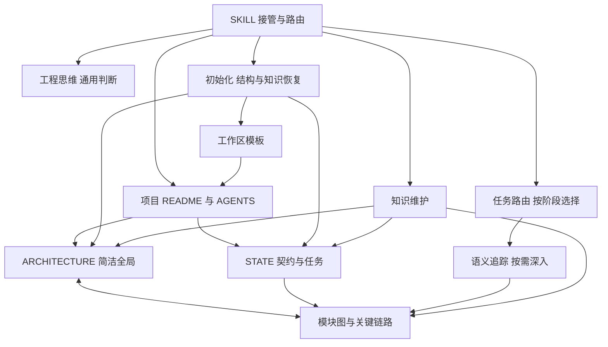
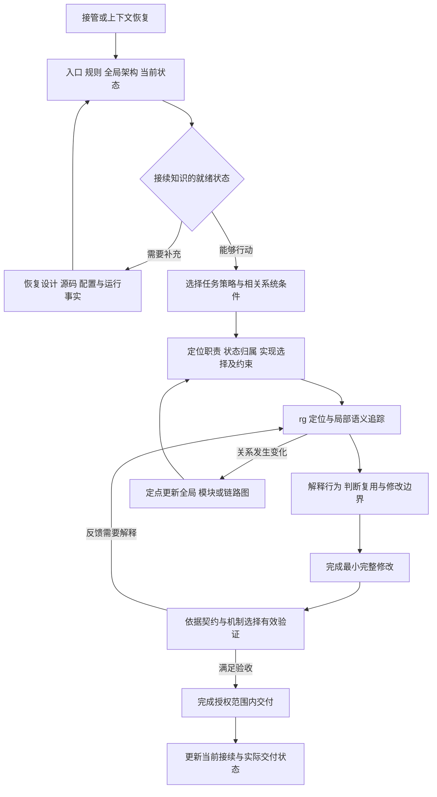

# arch-thinking-skill

面向软件系统的理解、实现与演进。全局架构指导局部语义追踪，代码和运行反馈修正系统模型；阶段策略完成当前任务，工作区文档使理解能够持续接续。

适用于按批准设计实施、功能迭代、Debug、重构、PR 和运维。大型遗留库是其中一个深入场景：需要辨认多套实现、恢复隐含契约、平衡复用与新逻辑并把握修复边界。

## 渐进加载与职责

| 入口 | 职责与加载条件 |
| --- | --- |
| [SKILL](SKILL.md) | 接管、公共方法和按需路由 |
| [AGENTS](AGENTS.md) | 维护本 skill 的职责与原始规则 |
| [工程思维](assets/workspace/工程思维.md) | 全局与局部切换的完整方法及具体判断案例；初始化后由工作区持有 |
| [任务路由](references/task-routing.md) | 根据当前任务和系统条件选择实施、Debug、重构、遗留库或交付策略 |
| [语义追踪](references/flow-tracing.md) | 真实路径、生产消费、状态、时序与责任边界 |
| [初始化](references/initialization.md) | 接入已有文档，补齐结构并恢复真实系统知识 |
| [知识维护](references/knowledge-maintenance.md) | 文件职责、图、变化回传与接续 |
| [工作区模板](assets/workspace/README.md) | README、AGENTS、工程思维、ARCHITECTURE、STATE；按实际缺口使用 |
| [辅助脚本](scripts/arch_memory.py) | init / impact / check；只执行机械辅助 |

工程正文保存在工作区，设计可以来自 chat、文档或 issue。现有同职责资产直接继承，源码和 Git 提供具体证据与历史。默认使用工作区内普通文件，复杂模块和链路按需展开。

## 图 1：Skill 与工作区如何衔接



方法、策略、项目知识和机械工具分别维护。入口保持短，所需细节沿实际任务加载。

## 图 2：行动与理解共同迭代



调查与实施可以往返，文档更新由有价值的关系变化触发。新系统沿设计建立实现；成熟系统按任务复用；遗留库在实际路径与兼容关系清楚后确定修改范围。

## 初始化与接续

用户明确要求初始化，或长期维护、跨模块任务缺少可接续的系统知识时，读取[初始化流程](references/initialization.md)。脚本补缺文件，Agent 继续填写真实系统图、任务契约、实现差距、证据和下一动作：

```bash
python3 scripts/arch_memory.py init --root /path/to/repo
```

已有其他文档位置时指定 `--memory-root`。旧版 `.arch/` 的接续规则见初始化流程。图谱服务与检索插件属于可选外部能力；本 skill 的完整工作路径使用文档、rg、源码、Git 和必要的运行证据。

## 方法边界

系统理解由真实契约、生产消费、存储计算通信、状态生命周期、复用与交付共同约束。长期知识归并保留后续需求、故障与迁移仍会用到的机制区别；当前任务的过程由任务记录和 Git 承接。六条工程判断规则保存在[工程思维](assets/workspace/工程思维.md#六条工程判断规则原文保留)。

相关机制参照：[Go pipelines](https://go.dev/blog/pipelines)解释生产者退出与资源释放；[Tokio channels](https://tokio.rs/tokio/tutorial/channels)区分交接与完成；[Google code review](https://google.github.io/eng-practices/review/reviewer/looking-for.html)结合整体设计、真实行为和变更上下文审查。具体项目按其语言、运行时和接口语义应用。
