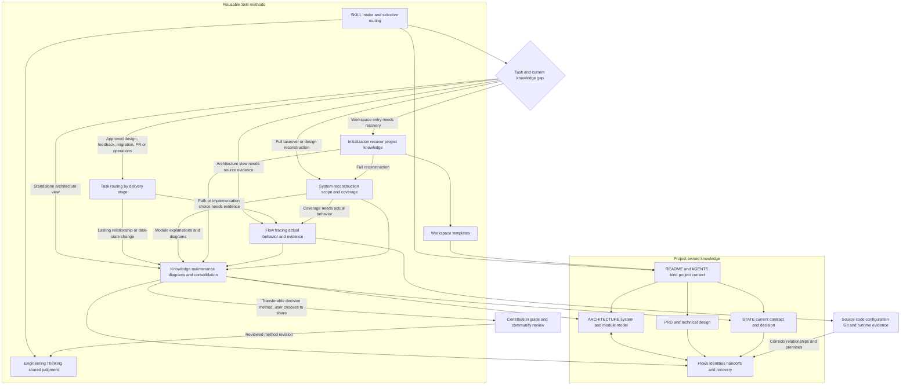
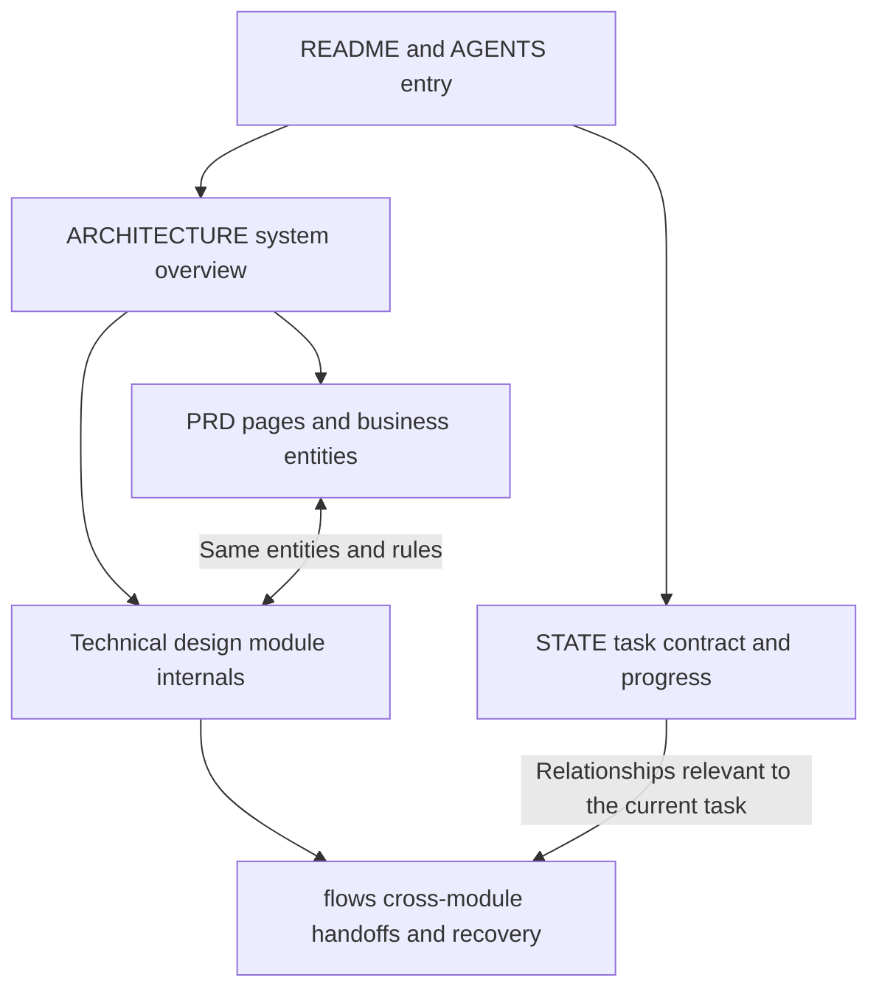
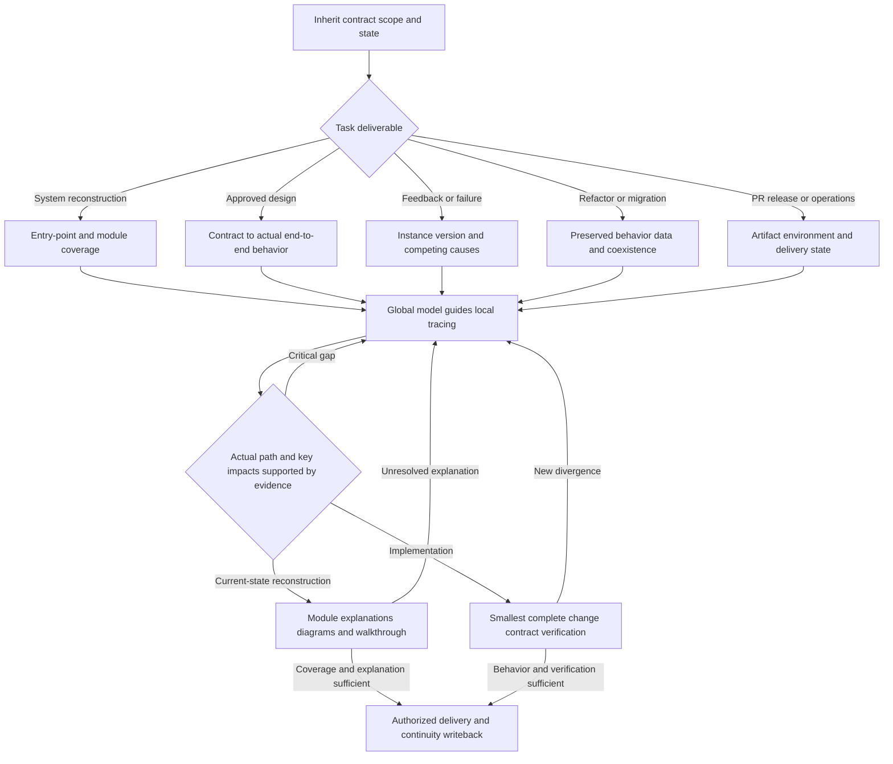

# Architecture Thinking

**English** | [简体中文](README.zh-CN.md)

[](#codex)
[](#dsh)
[](LICENSE)

> Lightweight dependency injection, progressive loading, separation of instructions and knowledge, task-aware routing, evidence-linked writeback and consolidation, and self-distillation.

> If you successfully distill a way of thinking you once took pride in into AI, will you celebrate its newfound independence—or grieve that you no longer need to experience that act of thinking yourself?
>
> A person can boldly seek a new self while sincerely mourning the one left behind. Soaked by the cold rain at the world's end, may we warm our hearts again, dispel the gloom, and bravely seek that changing shade of blue beyond the night.

`arch-thinking-skill` gives **Codex and dsh (DeepSeek Harness)** a method for understanding, implementing, and evolving software systems. It connects global architecture, local code semantics, failure attribution, and workspace memory: inherit existing designs and task state, reason along actual execution paths, make and verify changes, deliver working behavior, and write reusable knowledge back to the project.

It supports feature implementation, system takeover, debugging, refactoring, pull requests, and operations. For legacy systems with hundreds of thousands of lines of code, it emphasizes actual implementation selection, implicit contracts, state ownership, and change impact. Where a PRD and technical design have already been approved, it concentrates on completing the end-to-end behavior specified by those contracts.

[Highlights](#highlights) · [Lightweight Design](#lightweight-design) · [Design Comparison](#design-comparison-with-established-skills) · [Architecture](#architecture-and-workflow) · [Self-Distillation](#self-distillation-and-community-contributions) · [Use Cases](#use-cases) · [Installation](#installation-and-usage) · [References](#scope-and-references)

## Highlights

**Read code as a system, turn evidence into engineering decisions, and make the understanding gained in one task the starting point for the next.**

| Real engineering difficulty | How Architecture Thinking handles it | Reusable capability |
| --- | --- | --- |
| Similar implementations appear in many places; the agent repeatedly searches the wrong code | Use global responsibilities to choose an entry point, verify registration, configuration, calls, and state reads/writes; feed local findings back into the system model | **Global understanding ↔ local tracing:** know where to investigate and how findings change the larger explanation |
| Reusing old logic may affect upstream and downstream behavior; duplicating it introduces more states and branches | Recover implicit contracts from callers, implementations, and consumers; compare conditions for reuse, adaptation, or independent responsibility | **Evidence-backed reuse and change boundaries:** preserve legitimate business differences while repairing the necessary responsibility |
| The same failure could arise from an old value being committed, a later overwrite, or reading a stale replica | Find observations that distinguish competing explanations; trace object identity, versions, and handoffs before choosing where to fix | **Mechanism-based attribution:** each investigation helps decide the next engineering action |
| Tests pass but users fail through another entry point, configuration, or recovery path | Explain the actual path first, then align verification with affected modules, state transitions, and user behavior | **Architecture-aligned verification:** check real contracts and critical handoffs |
| Reviewers of a large codebase must otherwise rely on an agent's verbal conclusions | Diagrams identify actual implementations, state owners, important branches, and evidence locations; text explains conditions and consequences | **Traceable decision views:** humans can inspect evidence, understand impact, and compare designs |
| New sessions repeatedly rediscover the repository while old summaries diverge from reality | Persist the system explanation and current task state; revise authoritative text when new evidence arrives, then update affected diagrams and entry points | **Updatable long-term memory:** resume from the current explanation and its evidence |
| Accumulated experience becomes vague as summaries compress away meaningful distinctions | Merge redundant explanations while preserving validity conditions, causal mechanisms, and differing responses to future events | **High-fidelity consolidation:** shorter knowledge still guides new requirements, failures, and migrations |

Day-to-day tools are **rg/grep, source code, Git, ordinary Markdown, and runtime observations when needed**. See [Engineering Thinking](skills/arch-thinking-skill/assets/workspace/engineering-thinking.md) for the complete reasoning method.

## Lightweight Design

> Give each method a clear responsibility; let knowledge grow through practice.

**Organize the Skill like lightweight agent infrastructure: an entry point enables discovery, routing selects methods, explicit dependencies compose them, and the workspace holds memory.** Markdown is readable, editable, and versionable; dependencies, knowledge ownership, and update responsibilities make the files work together over time.

One long prompt can express a set of requirements. As tasks and projects develop, stable rules, reusable cases, historical conclusions, and current execution state have different scopes and rates of change. This Skill separates those responsibilities so that each read has a reason and each update has an owner.

| Design mechanism | Implementation | Engineering benefit |
| --- | --- | --- |
| **Explicit dependency injection** | `SKILL.md` declares task-specific methods; the project entry point binds real designs, architecture, and state, which the agent reads through these dependencies | Combine reusable methods with project context at the point of use while honoring existing designs and local rules |
| **Progressive loading** | Discover the skill name and description, load the entry point, then read relevant references and source code | Keep context focused on the current decision while allowing deeper investigation on demand |
| **Instruction/knowledge separation** | Stable instructions define working behavior; Engineering Thinking stores decision methods; project documents contain sourced system facts and current understanding | Reuse methods across projects, correct facts independently, and preserve authorization boundaries for rule changes |
| **Routing by task and knowledge gap** | Implementation, system reconstruction, debugging, migration, and delivery have different strategies; switch between global and local reasoning as evidence gaps demand | Match investigation depth and documentation scope to the work; act when understanding supports a decision |
| **Writeback and consolidation** | Revise the authoritative source for new evidence, propagate changes through real dependencies to diagrams and entry points, and preserve validity conditions and causal distinctions when merging | Keep current understanding inheritable and let accumulated knowledge shape future decisions |

Dependency injection is performed through the host agent's skill discovery and explicit file reads. The runtime relies on the existing agent, filesystem, Git, and command tools; helper scripts only initialize files and check references. **Lightweight describes runtime dependencies, loading scope, and maintenance overhead. Method depth comes from traceable semantics and evidence.**

## Design Comparison with Established Skills

**In complex systems, the difficult decisions lie between workflow steps: where to look, what to change, which existing behavior to preserve, and what understanding the next session should inherit.**

| Related approach | Primary focus | Integration gap in complex engineering | Architecture Thinking's design advantage |
| --- | --- | --- | --- |
| **[Superpowers](https://github.com/obra/superpowers#the-basic-workflow)** · Development workflow and [TDD](https://github.com/obra/superpowers#philosophy) | Requirements, planning, worktrees, test-driven implementation, review, and delivery | Approved designs meet historical implementations; actual entry paths, implicit contracts, state ownership, and compatibility boundaries still need to be recovered, and tests must exercise the intended behavior | **Implementation and verification driven by semantics and contracts.** Compare approved design with real behavior, trace state changes and consumers, change the responsible boundary, and align necessary checks with business paths and handoffs |
| **[Planning with Files](https://github.com/OthmanAdi/planning-with-files#the-3-file-pattern)** · File-based planning | Preserve plans, findings, progress, and continuity through hooks | Beyond resuming a task, durable system knowledge requires evidence, validity conditions, and propagation of changes | **Evolving system knowledge.** Give architecture, contracts, and state clear owners; update along dependencies and consolidate without losing distinctions that affect subsequent decisions |
| **[Anthropic Skills](https://github.com/anthropics/skills#about-this-repository)** · Capability packaging and on-demand loading | Discover and load reusable instructions, scripts, and references | Long-running engineering needs a connection between capabilities, project designs, actual implementations, current state, and knowledge maintenance | **Composing methods over a shared system model.** Explicit routing and method dependencies connect to the project knowledge entry point; local evidence continually corrects an explanation that persists across sessions |

These design approaches can be combined. Architecture Thinking joins **system explanation, engineering decisions, and knowledge evolution** in one working loop so that each task leaves useful system understanding that changes with real conditions.

## Architecture and Workflow

Responsibilities, method dependencies, workspace knowledge, and task execution connect through three architecture views. The first shows the complete relationship between the Skill and a project workspace; the other two expand document ownership and task execution.

### Progressive Loading and Responsibilities

| Entry point | Responsibility and when to load |
| --- | --- |
| [SKILL](skills/arch-thinking-skill/SKILL.md) | Task intake, shared methods, and selective routing |
| [AGENTS](AGENTS.md) | Rules and maintenance responsibilities for this Skill |
| [Contribution guide](CONTRIBUTING.md) | Prepare an Issue or method PR after the user chooses to contribute; guide community review and consolidation |
| [Engineering Thinking](skills/arch-thinking-skill/assets/workspace/engineering-thinking.md) | Complete method for recovering contracts, composing behavior, attributing failures, and choosing edit boundaries; copied into initialized workspaces |
| [Task routing](skills/arch-thinking-skill/references/task-routing.md) | Select delivery strategy by task stage; switch global/local investigation by knowledge gaps |
| [System reconstruction](skills/arch-thinking-skill/references/system-reconstruction.md) | Scope full-system coverage, reverse-engineer PRD/technical design, and define completion criteria |
| [Flow tracing](skills/arch-thinking-skill/references/flow-tracing.md) | rg/grep search scope, actual paths, contract recovery, factual tracing, and discriminating evidence |
| [Initialization](skills/arch-thinking-skill/references/initialization.md) | Integrate existing project documents and recover real system knowledge |
| [Knowledge maintenance](skills/arch-thinking-skill/references/knowledge-maintenance.md) | Evidence-linked diagrams, coverage, propagation, faithful consolidation, and continuity |
| [Workspace templates](skills/arch-thinking-skill/assets/workspace/README.md) | README, AGENTS, Engineering Thinking, ARCHITECTURE, and STATE templates; use only the missing parts |
| [Helper script](skills/arch-thinking-skill/scripts/arch_memory.py) | `init` / `impact` / `check`; mechanical assistance only |

The task determines the delivery route; the current knowledge gap determines which method to load next. The full procedures live in [Task routing](skills/arch-thinking-skill/references/task-routing.md).

| Task entering the Skill | First route | Load further when |
| --- | --- | --- |
| Approved design to implement | Recover the contract and finish the actual end-to-end path | Flow tracing for competing implementations or cross-module state; knowledge maintenance for lasting changes |
| User feedback or production failure | Fix the instance, version, expected behavior, and observed path | Flow tracing for competing causes; knowledge maintenance when the system explanation changes |
| Refactor, replace, or migrate | Fix the behaviors to preserve, then compare ownership, data, and coexistence | Flow tracing for historical consumers and recovery; knowledge maintenance for changed responsibilities |
| PR, release, or operations | Check the change, artifact, environment, handoffs, and observed delivery state | Flow tracing for runtime divergence; knowledge maintenance for durable operational knowledge |
| Full system takeover or design reconstruction | Build entry-point and module coverage, then explain product and technical behavior | Load system reconstruction, flow tracing, and knowledge maintenance together; initialization fills a missing project entry |
| Workspace initialization or standalone architecture view | Recover project knowledge or the requested system view | Initialization and knowledge maintenance; add flow tracing for source-backed relationships |

System knowledge stays in the project workspace. Designs can originate in chat, documents, or issues; existing assets with the same responsibility remain authoritative and are checked against requirements, code, and versions. Investigate locally according to impact; reconstruct the full system using a module coverage list.

### Figure 1: Skill, Workspace, and Knowledge Flow



The task selects the delivery method, then a concrete knowledge gap calls for tracing, reconstruction, or maintenance. The project entry point binds its own design and state; source evidence corrects the system model, and knowledge maintenance writes the revised explanation back to its owner. With the user's choice, transferable decision methods enter community review and improve the shared method.

### Figure 2: How Workspace Documents Connect



The workspace holds actual project knowledge. ARCHITECTURE identifies modules; PRD and technical design connect through shared business objects; flows detail cross-module identities and recovery; STATE preserves the current contract, gaps, and next action. Existing project entry points bind concrete file locations.

### Figure 3: From Investigation to Delivery



Local evidence revises the model; model gaps guide the next trace. Reconstruction delivers when the agreed scope can be explained; implementation delivers when the target behavior and affected contracts have been verified.

## Self-Distillation and Community Contributions

### Self-Distillation

> May every problem solved leave a light for the journey ahead.

Every user is encouraged to distill engineering judgment into reusable capability. Capture the moment when a decision changed: what was known, which evidence changed the interpretation, and what conditions made the chosen action valid. Turn distinctions learned in practice into methods, then let later practice challenge and refine those methods.

Write project-specific discoveries back into architecture, module, or task documents. Distill portable knowledge into **trigger conditions → decision evidence → action choice → applicability**; share it only after removing private information. When consolidating knowledge, recover the original decisions from the retained explanation and challenge it with a new requirement, failure, or recovery scenario. User-defined rules and approved designs remain subject to their original authority.

**The measure of successful distillation is how many real decisions the compressed knowledge can still guide.** When work produces a substantial generalizable insight, the agent can briefly identify a contribution candidate and help express the decision mechanism. The user chooses whether to keep it locally or share a sanitized version with the community.

**Real task → local distillation → user chooses to contribute → Issue / method PR → community review and consolidation → updated shared methods.** Project facts stay in the user's workspace; transferable engineering methods can become shared knowledge.

### Feedback and Contributions

**When experience changes how you make an engineering decision, consider bringing that distinction back to the community.**

Use an [Issue](https://github.com/jiale-li-orion/arch-thinking-skill/issues) when the mechanism or applicability is still uncertain; submit a [PR](https://github.com/jiale-li-orion/arch-thinking-skill/pulls) when you can specify the conditions, evidence, and revision to an existing method. Agents may help prepare the material, but public submission requires the user's authorization. Community review integrates useful findings into existing methods.

See [CONTRIBUTING.md](CONTRIBUTING.md) for contribution preparation and review, and [AGENTS.md](AGENTS.md) for maintenance responsibilities.

## Use Cases

| Task | Skill focus | Deliverable |
| --- | --- | --- |
| Implement or resume a feature after PRD / technical design approval | Inherit design decisions, compare existing capabilities, and complete the behavior from entry point to final consumer | Complete implementation, relevant verification, and delivery within authorization |
| Take over a large system with outdated or missing documentation | Establish module coverage; reconstruct product rules, internal mechanisms, and cross-module relationships | Evidence-linked system overview, module descriptions, and PRD / technical design reconstruction where needed |
| Debug production reports, cross-module issues, or multiple parallel implementations | Fix the specific instance and version, follow the actual path, and distinguish competing mechanisms | Cause and trigger conditions, repair ownership, compatibility effects, and results |
| Reuse existing logic, refactor, or migrate | Compare behavioral contracts; trace shared state, historical data, in-flight work, and version coexistence | Decision among reuse, adaptation, and separate ownership; explainable migration |
| Resume long-running work in a new session | Recover the current system explanation, design constraints, verified progress, and next action | Context that lets the next session continue directly |

## Installation and Usage

### Installation and Updates

The maintained agent environments are **Codex and dsh**. Both use the same [`skills/arch-thinking-skill/`](skills/arch-thinking-skill/) content, references, and templates, while project knowledge stays in the target workspace. Reading relies on agent file and command tools; helpers use Python 3, and source searches preferentially use ripgrep.

#### Codex

Install through the [Codex plugin package](.codex-plugin/plugin.json):

```bash
codex plugin marketplace add jiale-li-orion/arch-thinking-skill
codex plugin add arch-thinking-skill@arch-thinking-skill-marketplace
```

Alternatively, use `$skill-installer` in Codex with the standalone Skill URL:

```text
https://github.com/jiale-li-orion/arch-thinking-skill/tree/main/skills/arch-thinking-skill
```

Choose one installation method. Verify installed plugins with `codex plugin list --json`. Open a new session, select `arch-thinking-skill` from the Skill list, or explicitly ask Codex to use it.

To update the plugin:

```bash
codex plugin marketplace upgrade arch-thinking-skill-marketplace
codex plugin add arch-thinking-skill@arch-thinking-skill-marketplace
```

For a standalone installation, update the complete Skill directory at its installed location. Open a new session afterward so the agent reads the updated files.

#### dsh

Use dsh's filesystem Skill loader. For macOS / Linux:

```bash
mkdir -p "$HOME/.local/share/agent-skills"
git clone https://github.com/jiale-li-orion/arch-thinking-skill.git \
  "$HOME/.local/share/agent-skills/arch-thinking-skill"
mkdir -p "${DSH_HOME:-$HOME/.dsh}/skills"
ln -s "$HOME/.local/share/agent-skills/arch-thinking-skill/skills/arch-thinking-skill" \
  "${DSH_HOME:-$HOME/.dsh}/skills/"
```

The loaded path is `~/.dsh/skills/arch-thinking-skill/SKILL.md`, or the equivalent under a custom `DSH_HOME`. You may instead copy the complete `skills/arch-thinking-skill/` folder there or put it under the project's `.dsh/skills/`. Preserve `references/`, `assets/`, and `scripts/` so relative paths remain valid.

The dsh profile must expose `dsh-skill`, `dsh-skill-filesystem`, and `dsh-tool-skill`. The loader discovers Skill directories immediately below its root, so the symlink above points to the *inner* Skill folder. Once in the target project's dsh session, invoke:

```text
/arch-thinking-skill Continue implementation from the approved technical design and maintain the current architecture and task state.
```

Update the linked repository:

```bash
git -C "$HOME/.local/share/agent-skills/arch-thinking-skill" pull --ff-only
```

dsh reads the current Skill content when loading it again. A new session can resume from the updated instructions. If you installed by copying the folder, synchronize its full contents. See the dsh documentation for [directory discovery](https://github.com/deepseek-ai/deepseek-harness/blob/main/packages/skill/skill-filesystem/README.md) and [invocation](https://github.com/deepseek-ai/deepseek-harness/blob/main/packages/skill/tool-skill/README.md).

### Getting Started

In Codex, select the Skill or say "use arch-thinking-skill." In dsh, invoke `/arch-thinking-skill`. Provide the objective, existing materials, and authorization. For example:

**Implement an approved design**

> Use arch-thinking-skill. The PRD and technical design are approved. Inherit those decisions, examine the implementation, reuse capabilities with matching contracts, finish the remaining business path and necessary verification, then open a PR.

**Take over a large codebase**

> Use arch-thinking-skill to take over this repository. Establish an overview and module coverage, then recover actual product behavior and technical mechanisms module by module. Link architecture and module diagrams to source code, including normal behavior, recovery paths, and historical branches.

**Investigate a real failure**

> Use arch-thinking-skill to investigate this report. Trace the selected execution path using request identity, logs, and deployment versions. Explain how state reached the incorrect outcome, determine repair responsibility and affected behavior, then implement the fix.

**Initialize durable context across sessions**

> Use arch-thinking-skill to initialize a resumable workspace. Reuse existing documents and record actual system explanations, task state, and evidence entry points. In future sessions, recover context from README, AGENTS, ARCHITECTURE, and STATE before continuing.

Both supported agents can maintain the same workspace knowledge. Design requirements, implementation facts, and runtime feedback retain distinct evidence. The agent chooses reading depth and action based on the task. See [Initialization and Continuity](#initialization-and-continuity) for details.

### Initialization and Continuity

Read the [initialization reference](skills/arch-thinking-skill/references/initialization.md) when the user requests initialization or a long-running, cross-module task lacks resumable system knowledge. The helper adds missing files; the agent then fills in actual diagrams, contracts, implementation gaps, evidence, and next actions.

Run from this repository's root. With a plugin or standalone installation, the agent should use the `scripts/arch_memory.py` in its installed Skill resources:

```bash
python3 skills/arch-thinking-skill/scripts/arch_memory.py init --root /path/to/repo
```

Use `--memory-root` when architecture knowledge already lives elsewhere. The initialization reference documents continuity with older `.arch/` directories. Graph services and retrieval plugins are optional; the complete workflow runs on documents, rg, source code, Git, and necessary runtime evidence.

For whole-system reconstruction, also load [system reconstruction](skills/arch-thinking-skill/references/system-reconstruction.md). ARCHITECTURE provides a concise overview; PRDs explain business behavior by page and entity; technical designs contain module-level diagrams, internal state, and branches; flows explain cross-module handoffs and recovery. Existing documents may fulfill those roles. Completion requires coverage of the agreed modules and an explanation from which behavior and change impact can be derived.

## Scope and References

### Method Boundaries

System understanding is constrained by actual contracts, producer-consumer relationships, storage/computation/communication, state lifecycles, reuse, and delivery. Consolidation must preserve distinctions that change future requirements, failures, or migration decisions. Detailed execution histories belong to task records and Git. The [six engineering decision rules](skills/arch-thinking-skill/assets/workspace/engineering-thinking.md#six-engineering-decision-rules) are maintained in Engineering Thinking.

Related mechanisms include [Go pipelines](https://go.dev/blog/pipelines) for producer exit and resource release, [Tokio channels](https://tokio.rs/tokio/tutorial/channels) for distinguishing a handoff from completed work, and [Google code review guidance](https://google.github.io/eng-practices/review/reviewer/looking-for.html) for inspecting overall design, actual behavior, and change context. Apply them according to each project's language, runtime, and interface semantics.

### Research and Engineering References

The sources below inform search, attribution, context organization, and verification. [Flow tracing](skills/arch-thinking-skill/references/flow-tracing.md#方法依据与迁移范围) documents their relationship to the implementation methods.

| Recent source | Engineering judgment adopted | Where it appears |
| --- | --- | --- |
| [Teaching Agents to Code Reliably](https://arxiv.org/abs/2610.03984), 2026-10-02, preprint | Ask whether verification distinguishes the intended behavior; separate feedback arising from the patch, tests, and environment | [Verification and delivery](skills/arch-thinking-skill/references/task-routing.md#验证与交付) |
| [SemNav](https://arxiv.org/abs/2609.31176), 2026-09-25, preprint | Preserve source evidence for candidates; revise task relevance as new evidence appears | [Candidates and evidence](skills/arch-thinking-skill/references/flow-tracing.md#将候选变成可用证据) |
| [CodeGrep](https://arxiv.org/abs/2608.05886), 2026-08-06, preprint | Separate exploratory candidates from evidence used for repairs; choose result shapes by how evidence will be consumed | [Candidates and evidence](skills/arch-thinking-skill/references/flow-tracing.md#将候选变成可用证据) |
| [LLM Agents Can See Code Repositories / SeeRepo](https://arxiv.org/abs/2606.14061), June 2026 preprint, [ASE 2026](https://conf.researchr.org/details/ase-2026/ase-2026-research-track/33/LLM-Agents-Can-See-Code-Repositories) (October) | Choose subgraphs by the current question and use structural navigation alongside precise source reading | [Diagrams from evidence](skills/arch-thinking-skill/references/knowledge-maintenance.md#从证据生成图) |

| Source | Relevant reading | Skill capability informed |
| --- | --- | --- |
| Li & Coblenz, FSE 2026, [A Grounded Theory of Debugging in Professional Software Engineering Practice](https://arxiv.org/abs/2602.11435) | Sections 2–5: debugging observations, updated system understanding, navigation, and execution | Recover facts before explanations; connect compositional reasoning to investigation |
| Ma et al., ICSE 2026, [Enhancing Issue Localization Agent with Tool-Interactive Training](https://conf.researchr.org/details/icse-2026/icse-2026-research-track/95/Enhancing-Issue-Localization-Agent-with-Tool-Interactive-Training) ([ToolTrain preprint](https://arxiv.org/abs/2508.03012)) | Sections 3–5 and appendices B–C: tool interaction training, multi-step localization, evaluation scope | Refine queries based on source evidence; cross symbol and lifecycle boundaries |
| Yang et al., NeurIPS 2024, [SWE-agent: Agent-Computer Interfaces Enable Automated Software Engineering](https://arxiv.org/abs/2405.15793) | Section 3 and 5.1: search/reading interfaces and ablations | Select evidence shapes by question; move from file discovery to complete semantic units |
| Anthropic, 2025, [Effective context engineering for AI agents](https://www.anthropic.com/engineering/effective-context-engineering-for-ai-agents) | Context retrieval and agentic search | Combine stable instructions and just-in-time retrieval through progressive loading |
| [ripgrep official guide](https://github.com/BurntSushi/ripgrep/blob/master/GUIDE.md) | Automatic filtering, search scope, literal matches, and output modes | Interpret search coverage, empty results, and truncation accurately |

## Support, Sharing, and License

If this method helped you understand a system, locate a repair, or resume a new session without losing context, consider giving the repository a [Star](https://github.com/jiale-li-orion/arch-thinking-skill/stargazers) and sharing it with other builders.

Forks and shared usage patterns are welcome. Please retain a link to the project when referencing it; code and materials are provided under the [MIT License](LICENSE).

May lessons from individual practice become shared knowledge, and may each builder leave behind methods others can use.
