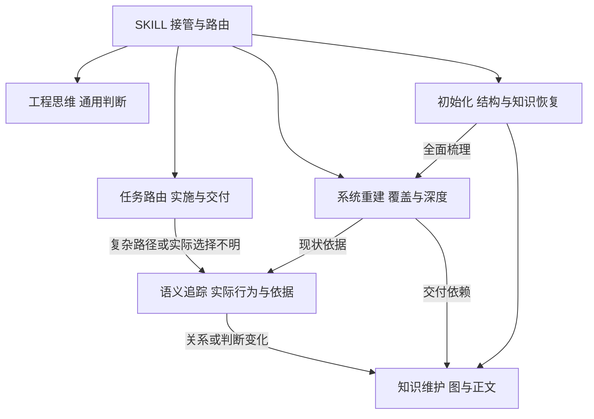
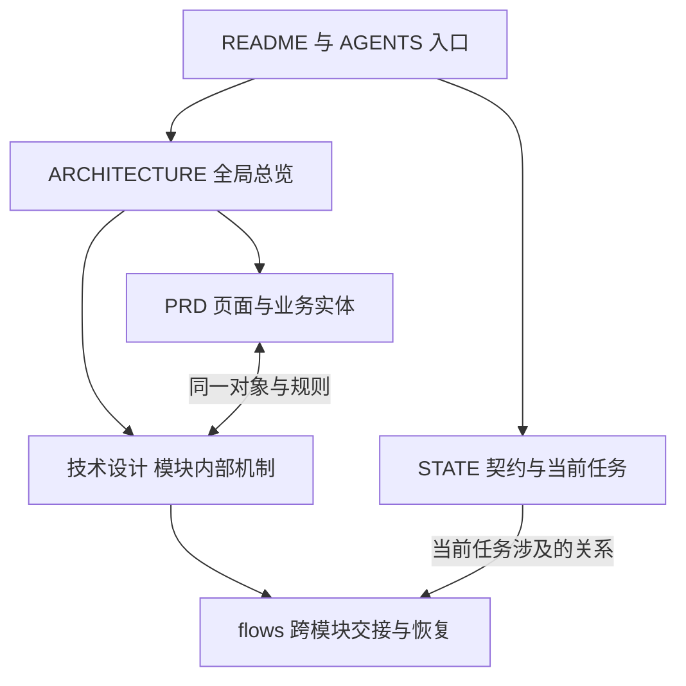
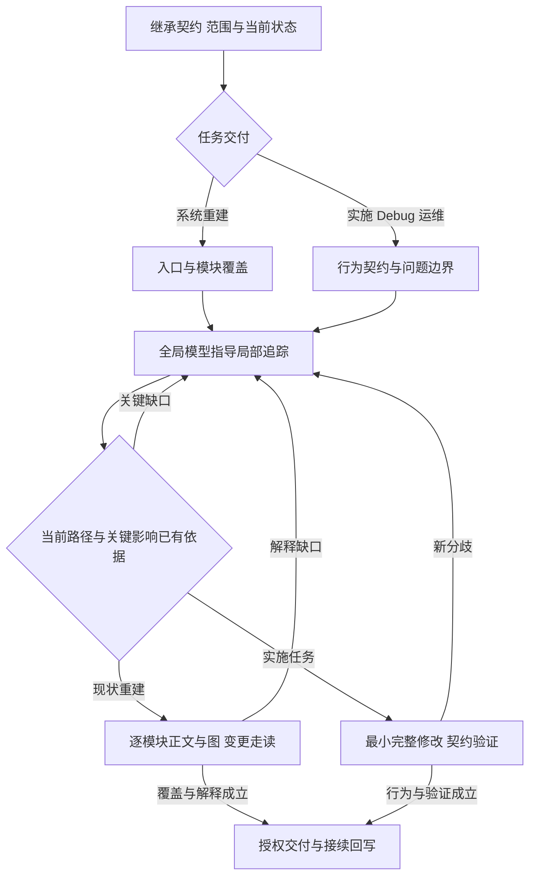

# Architecture Thinking

[](#codex)
[](#dsh)
[](LICENSE)

**让 Agent 解释系统怎样运行、判断应该改哪里，并在下一次会话接着做。**

`arch-thinking-skill` 为 **Codex 和 dsh（DeepSeek Harness）** 提供软件系统理解、实现与演进的方法。它把全局架构、局部代码语义、故障归因和工作区记忆连接起来：先继承设计与当前状态，沿真实路径形成判断，再完成修改、验证和交付，并把有复用价值的认识写回项目。

适用于新功能实施、系统接管、Debug、重构、PR 和运维。面对二十万行以上的遗留系统，重点恢复多套实现的实际选择、隐含契约、状态所有权与变更影响；面对已经批准的 PRD 和技术设计，重点沿既定契约把完整业务链路做好。

[核心亮点](#核心亮点) · [适用场景](#适用场景) · [安装与更新](#安装与更新) · [开始使用](#开始使用) · [方法导航](#渐进加载与职责) · [论文参考](#论文与工程实践参考)

## 核心亮点

| 能力 | Agent 具体怎样工作 | 你能够得到什么 |
| --- | --- | --- |
| **全局理解 ↔ 局部追踪** | 从入口、职责、状态归属选择搜索方向；读到新写入者、旁路或配置分支后修正系统模型 | 能解释当前行为、指导下一处修改的架构理解 |
| **从代码恢复隐含契约** | 对照调用方的使用方式、实现的前提和消费者的依赖，追同一业务对象的状态与生命周期 | 散落在多个模块里的责任与约束，以及复用、适配的依据 |
| **归因与修改边界一起推导** | 连接触发条件、实际路径、状态变化与用户观察；比较会导致不同修复选择的机制 | 原因解释、区分证据和最小完整修改的范围 |
| **给人类可追溯的系统现状** | 架构图、模块图、时序和状态图链接源码与配置，关键关系标明运行条件和依据 | 能沿图追问、检查影响并作出决策的系统说明 |
| **Skill 与工作区记忆一体** | 用 README／AGENTS 绑定入口，ARCHITECTURE 保存系统解释，STATE 保存当前契约与下一动作 | 上下文压缩或换会话后可以继续使用的项目知识 |
| **高保真更新知识** | 保留关键判断的成立条件、证据和后继事件区别；新写入者或部署变化触发相关判断回读 | 能继续指导后续需求、故障和迁移的记忆 |
| **语义优先的有效验证** | 先解释代码行为，再按实际架构、模块交接和状态转换选择验证；复用有效的现有检查 | 与真实契约相对应的验证依据和明确交付状态 |

日常工具是 **rg／grep、源码、Git、普通 Markdown 和必要的运行观测**。入口保持简洁，具体方法随任务渐进加载；图与详细文档按实际理解和接续需要维护。完整判断方法见[工程思维](skills/arch-thinking-skill/assets/workspace/工程思维.md)。

## 适用场景

| 你的任务 | Skill 的工作重点 | 交付落点 |
| --- | --- | --- |
| PRD／技术设计已写好，开始或继续实现 | 继承设计决策，对照现有能力，沿入口到最终消费者补齐业务行为 | 完整实现、相关验证及当前授权范围内的交付 |
| 接手大型系统，文档陈旧或缺失 | 建立模块覆盖，恢复产品规则、模块内部机制及跨模块关系 | 带依据的系统总览、模块说明和按需恢复的 PRD／技术设计 |
| 线上反馈、跨模块 Bug、多套实现并存 | 固定实例与版本，追实际生效路径，用竞争解释决定定点取证 | 原因及触发条件、修复责任、兼容影响与结果 |
| 复用旧逻辑、重构或迁移 | 比较行为契约，追共享状态、旧数据、在途任务及版本共存 | 复用／适配／独立责任的选择，以及可解释的迁移过程 |
| 新会话接管、长期迭代 | 恢复当前解释、设计约束、真实进展和下一动作 | 可直接继续工作的上下文与证据入口 |

## 安装与更新

维护的 Agent 支持范围为 **Codex 与 dsh**。两端共用 [`skills/arch-thinking-skill/`](skills/arch-thinking-skill/) 的正文、参考资料和模板，项目知识保存在目标工作区。基础阅读使用 Agent 的文件与命令工具；辅助脚本使用 Python 3，代码检索优先使用 ripgrep。

### Codex

使用 [Codex 插件包](.codex-plugin/plugin.json)：

```bash
codex plugin marketplace add jiale-li-orion/arch-thinking-skill
codex plugin add arch-thinking-skill@arch-thinking-skill-marketplace
```

也可在 Codex 中使用 `$skill-installer`，给出独立 Skill 地址：

```text
https://github.com/jiale-li-orion/arch-thinking-skill/tree/main/skills/arch-thinking-skill
```

选择一种安装方式即可。插件安装状态可用 `codex plugin list --json` 核对。安装后开启新会话，在技能列表中选择 `arch-thinking-skill`，或明确要求使用它处理当前任务。

插件更新：

```bash
codex plugin marketplace upgrade arch-thinking-skill-marketplace
codex plugin add arch-thinking-skill@arch-thinking-skill-marketplace
```

独立 Skill 安装按其安装位置更新完整目录。更新后开启新会话，让 Agent 读取当前版本。

### dsh

通过 dsh 的文件系统 Skill 加载器使用同一份 Skill。下面适用于 macOS／Linux shell：

```bash
mkdir -p "$HOME/.local/share/agent-skills"
git clone https://github.com/jiale-li-orion/arch-thinking-skill.git \
  "$HOME/.local/share/agent-skills/arch-thinking-skill"
mkdir -p "${DSH_HOME:-$HOME/.dsh}/skills"
ln -s "$HOME/.local/share/agent-skills/arch-thinking-skill/skills/arch-thinking-skill" \
  "${DSH_HOME:-$HOME/.dsh}/skills/"
```

加载后的目录对应 `~/.dsh/skills/arch-thinking-skill/SKILL.md`；设置 `DSH_HOME` 时使用对应根目录。也可将完整 `skills/arch-thinking-skill/` 文件夹复制到该位置，或放入目标项目的 `.dsh/skills/`。保留 `references/`、`assets/` 和 `scripts/`，使按需读取的相对路径完整可用。

dsh profile 需要具备 `dsh-skill`、`dsh-skill-filesystem` 与 `dsh-tool-skill`。加载器按根目录的直接子目录发现 Skill；使用上面指向内部 Skill 目录的链接。进入目标项目的 dsh 会话后，发送：

```text
/arch-thinking-skill 按照已有技术设计继续实现，并维护当前架构与任务状态。
```

更新链接指向的仓库：

```bash
git -C "$HOME/.local/share/agent-skills/arch-thinking-skill" pull --ff-only
```

dsh 在再次加载 Skill 时读取当前正文；开启新会话可从更新后的正文重新接管。使用复制安装时同步更新整个 Skill 目录。加载规则见 dsh 官方的[目录发现](https://github.com/deepseek-ai/deepseek-harness/blob/main/packages/skill/skill-filesystem/README.md)与[调用方式](https://github.com/deepseek-ai/deepseek-harness/blob/main/packages/skill/tool-skill/README.md)。

## 开始使用

在 Codex 中选择该 Skill，或在请求中写明“使用 arch-thinking-skill”；在 dsh 中使用 `/arch-thinking-skill`。随后给出目标、已有材料和授权范围，例如：

**按设计实施**

> 使用 arch-thinking-skill。PRD 和技术设计已经确定，请继承这些决策，检查当前实现，复用契约一致的能力，完成剩余业务链路和必要验证，再提交 PR。

**接管大型系统**

> 使用 arch-thinking-skill 接管这个仓库。先建立系统总览和模块覆盖，再逐模块恢复当前产品行为与技术机制。架构图、模块图和正文要能追到源码，并解释正常、恢复及历史分支。

**追踪真实故障**

> 使用 arch-thinking-skill 调查这个反馈。根据请求身份、日志和部署版本追实际生效路径，解释状态怎样走到错误结果，判断修复责任与受影响行为，再完成修复。

**初始化与跨会话接续**

> 使用 arch-thinking-skill 初始化可接续的工作区。沿用已有文档，把系统解释、当前任务和证据入口写实。后续会话从 README、AGENTS、ARCHITECTURE 和 STATE 恢复，再继续当前任务。

同一份工作区知识可由两端继续维护。设计要求、实际实现与运行反馈各自保留依据；Agent 根据当前任务选择读取深度和行动。详细初始化与辅助命令见[初始化与接续](#初始化与接续)。

## 渐进加载与职责

| 入口 | 职责与加载条件 |
| --- | --- |
| [SKILL](skills/arch-thinking-skill/SKILL.md) | 接管、公共方法和按需路由 |
| [AGENTS](AGENTS.md) | 维护本 skill 的职责与原始规则 |
| [工程思维](skills/arch-thinking-skill/assets/workspace/工程思维.md) | 从隐含契约、组合解释与归因推导修改边界的完整方法；初始化后由工作区持有 |
| [任务路由](skills/arch-thinking-skill/references/task-routing.md) | 按任务阶段选择交付策略，按理解缺口切换全局分析、局部取证与实施 |
| [系统重建](skills/arch-thinking-skill/references/system-reconstruction.md) | 全面梳理、反推 PRD／技术设计或逐模块展开；负责覆盖、细节深度、产品技术映射与完成判据 |
| [语义追踪](skills/arch-thinking-skill/references/flow-tracing.md) | rg / grep 查询调整与覆盖、真实路径、契约恢复、事实调查与竞争解释取证 |
| [初始化](skills/arch-thinking-skill/references/initialization.md) | 接入已有文档，补齐结构并恢复真实系统知识 |
| [知识维护](skills/arch-thinking-skill/references/knowledge-maintenance.md) | 面向人类决策的现状图、证据与覆盖、判断前提回传及保真接续 |
| [工作区模板](skills/arch-thinking-skill/assets/workspace/README.md) | README、AGENTS、工程思维、ARCHITECTURE、STATE；按实际缺口使用 |
| [辅助脚本](skills/arch-thinking-skill/scripts/arch_memory.py) | init / impact / check；只执行机械辅助 |

SKILL 入口按任务目标加载方法依赖：全系统现状重建同时加载系统重建、语义追踪和知识维护；工作区知识缺失时再加载初始化。局部实施或 Debug 从任务路由进入，沿实际状态和实现分支加载语义追踪。图与变更影响解释由知识维护承接。旧文档过期的全面接管、反推 PRD／技术设计和逐模块梳理进入系统重建。

工程正文保存在工作区，设计可以来自 chat、文档或 issue。现有同职责资产沿用位置，内容依据任务契约、源码与版本核对。默认使用工作区内普通文件；局部任务按影响深入，全系统重建按模块清单逐项展开。

## 图 1：任务如何加载方法



任务决定交付责任，语义追踪恢复实现依据，知识维护承接图与正文。局部任务沿相关关系深入；全面梳理由系统重建补上逐模块覆盖和完成判据。

## 图 2：工作区文档如何互相定位



工作区保存实际项目知识。总览帮助选模块，PRD 与技术设计按业务对象互相定位，flows 展开跨模块身份和恢复；STATE 保存当前契约、差距和下一动作。具体文件由已有项目入口绑定。

## 图 3：调查怎样形成交付



局部证据持续修订模型，模型中的缺口决定下一段追踪。系统重建以覆盖清单和行为解释完成交付；实现任务以目标行为及受影响契约的验证完成交付。

## 初始化与接续

用户明确要求初始化，或长期维护、跨模块任务缺少可接续的系统知识时，读取[初始化流程](skills/arch-thinking-skill/references/initialization.md)。脚本补缺文件，Agent 继续填写真实系统图、任务契约、实现差距、证据和下一动作：

下面从本仓库根目录执行；通过插件或独立 Skill 安装时，Agent 使用其实际资源目录中的 `scripts/arch_memory.py`：

```bash
python3 skills/arch-thinking-skill/scripts/arch_memory.py init --root /path/to/repo
```

已有其他文档位置时指定 `--memory-root`。旧版 `.arch/` 的接续规则见初始化流程。图谱服务与检索插件属于可选外部能力；本 skill 的完整工作路径使用文档、rg、源码、Git 和必要的运行证据。

全面梳理同时加载[系统重建](skills/arch-thinking-skill/references/system-reconstruction.md)。ARCHITECTURE 承担简洁总览，PRD 按页面和实体解释业务，技术设计逐模块建图并展开内部状态与分支，flows 解释跨模块交接和恢复。职责可复用已有章节；完成标准是覆盖约定模块，并能沿正文推演行为和变更影响。用户认可的文档样本用于校准这些解释责任。

## 方法边界

系统理解由真实契约、生产消费、存储计算通信、状态生命周期、复用与交付共同约束。长期知识归并保留后续需求、故障与迁移仍会用到的机制区别；当前任务的过程由任务记录和 Git 承接。六条工程判断规则保存在[工程思维](skills/arch-thinking-skill/assets/workspace/工程思维.md#六条工程判断规则原文保留)。

相关机制参照：[Go pipelines](https://go.dev/blog/pipelines)解释生产者退出与资源释放；[Tokio channels](https://tokio.rs/tokio/tutorial/channels)区分交接与完成；[Google code review](https://google.github.io/eng-practices/review/reviewer/looking-for.html)结合整体设计、真实行为和变更上下文审查。具体项目按其语言、运行时和接口语义应用。

## 论文与工程实践参考

参考材料按其实际研究范围使用。论文提供观察、方法与实验依据，本 skill 将相关认识转化为工程操作；具体证据范围见[语义追踪的方法依据](skills/arch-thinking-skill/references/flow-tracing.md#方法依据与迁移范围)。

近期材料按首次公开时间与发表身份分别标注；操作细节留在对应正文。

| 近期来源 | 吸收的工程判断 | 正文位置 |
| --- | --- | --- |
| [Teaching Agents to Code Reliably](https://arxiv.org/abs/2610.03984)，2026-10-02，预印本 | 检查验证能否区分目标行为，分别解释补丁、测试和环境带来的反馈 | [验证与交付](skills/arch-thinking-skill/references/task-routing.md#验证与交付) |
| [SemNav](https://arxiv.org/abs/2609.31176)，2026-09-25，预印本 | 候选保留源码依据，任务关联随证据修订 | [候选与证据](skills/arch-thinking-skill/references/flow-tracing.md#将候选变成可用证据) |
| [CodeGrep](https://arxiv.org/abs/2608.05886)，2026-08-06，预印本 | 探索候选与后续修复证据分别组织，按消费方式选择信息形状 | [候选与证据](skills/arch-thinking-skill/references/flow-tracing.md#将候选变成可用证据) |
| [LLM Agents Can See Code Repositories / SeeRepo](https://arxiv.org/abs/2606.14061)，2026-06 首发，[ASE 2026](https://conf.researchr.org/details/ase-2026/ase-2026-research-track/33/LLM-Agents-Can-See-Code-Repositories)（10 月） | 以当前问题选择图的范围，结构导航与精确源码协作 | [从证据生成图](skills/arch-thinking-skill/references/knowledge-maintenance.md#从证据生成图) |

以下保留较早的方法基础与工具实践；会议年份和稿件首发年份分别理解。

| 来源 | 重点阅读 | 对应 Skill 能力 |
| --- | --- | --- |
| Li & Coblenz，FSE 2026，[A Grounded Theory of Debugging in Professional Software Engineering Practice](https://arxiv.org/abs/2602.11435) | §2–5：真实调试观察、系统理解的更新、导航与执行 | 先恢复事实，再形成解释；组合推理方向与取证方式 |
| Ma et al.，ICSE 2026，[Enhancing Issue Localization Agent with Tool-Interactive Training](https://conf.researchr.org/details/icse-2026/icse-2026-research-track/95/Enhancing-Issue-Localization-Agent-with-Tool-Interactive-Training)（[ToolTrain 稿件](https://arxiv.org/abs/2508.03012)） | §3–5、附录 B–C：工具交互训练、多步定位及评价范围 | 随源码证据改写查询，跨越符号与生命周期边界 |
| Yang et al.，NeurIPS 2024，[SWE-agent: Agent-Computer Interfaces Enable Automated Software Engineering](https://arxiv.org/abs/2405.15793) | §3、§5.1：搜索与阅读接口、接口消融 | 按问题选择结果形状，从文件分布进入完整语义单元 |
| Anthropic，2025，[Effective context engineering for AI agents](https://www.anthropic.com/engineering/effective-context-engineering-for-ai-agents) | Context retrieval and agentic search：按需读取的工程实践 | 稳定指引与即时检索协作，保持渐进加载 |
| [ripgrep 官方指南](https://github.com/BurntSushi/ripgrep/blob/master/GUIDE.md) | 自动过滤、路径范围、字面匹配与输出选项 | 准确解释搜索覆盖、空结果与截断 |

后续吸收材料时，先判断它改变了哪项工程选择，再修订对应权威正文。来源、证据范围和迁移动作一起保留；方法效果结合目标仓库的真实任务继续校正。

## 反馈与贡献

欢迎提交真实任务中的改进：[Issues](https://github.com/jiale-li-orion/arch-thinking-skill/issues) · [Pull requests](https://github.com/jiale-li-orion/arch-thinking-skill/pulls)。说明任务阶段、Agent 实际读取的内容、判断在哪一步偏离，以及建议怎样改变工程选择；提交前脱敏源码、日志和环境信息。

方法修改沿对应权威正文进行，入口和 README 维护导航。保留机制、适用条件及证据，按变更涉及的语义与行为验证。仓库维护规则见 [AGENTS.md](AGENTS.md)。

首页的信息组织参考 [Superpowers](https://github.com/obra/superpowers) 的工作方式与分平台安装呈现，以及 [Anthropic Skills](https://github.com/anthropics/skills) 的独立 Skill 结构与使用示例。工程方法由本仓库的工程思维和参考文档承接。

## 许可

[MIT License](LICENSE)。发布内容由 Git 跟踪，安装资源位于 `skills/arch-thinking-skill/`，本地归档由 `.gitignore` 排除。
