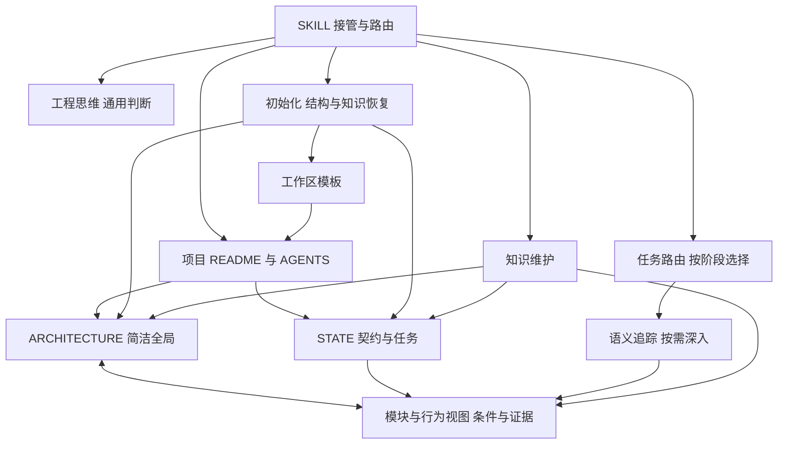
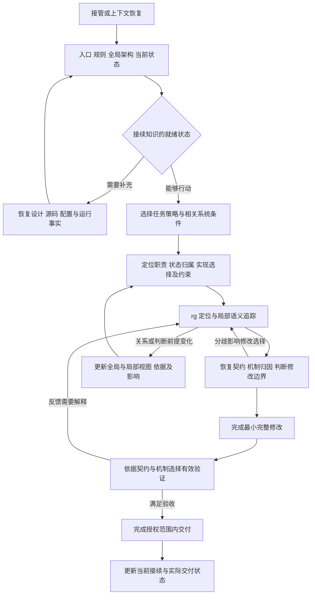

# arch-thinking-skill

面向软件系统的理解、实现与演进。全局架构指导局部语义追踪，代码和运行反馈修正系统模型；阶段策略完成当前任务，工作区文档使理解能够持续接续。

适用于按批准设计实施、功能迭代、Debug、重构、PR 和运维。大型遗留库是其中一个深入场景：需要辨认多套实现、恢复隐含契约、平衡复用与新逻辑并把握修复边界。

## 安装到 Codex

本仓库同时提供 [Codex 插件包](.codex-plugin/plugin.json)和可单独安装的 [Agent Skill](skills/arch-thinking-skill/SKILL.md)。安装插件：

```bash
codex plugin marketplace add jiale-li-orion/arch-thinking-skill
codex plugin add arch-thinking-skill@arch-thinking-skill-marketplace
```

只安装 Skill 时，在 Codex 中使用 `$skill-installer`，指定 `https://github.com/jiale-li-orion/arch-thinking-skill/tree/main/skills/arch-thinking-skill`。本地开发可将 `skills/arch-thinking-skill/` 链接到 `~/.codex/skills/arch-thinking-skill/`。安装后重启 Codex，让新会话发现 Skill。仓库根目录的 README 与 AGENTS 面向维护者；安装内容位于 `skills/arch-thinking-skill/`，工作区初始化按下文脚本及当地系统资料完成。

许可见 [MIT License](LICENSE)。仓库发布内容由 Git 跟踪；本地归档按当地 `.gitignore` 排除。

## 渐进加载与职责

| 入口 | 职责与加载条件 |
| --- | --- |
| [SKILL](skills/arch-thinking-skill/SKILL.md) | 接管、公共方法和按需路由 |
| [AGENTS](AGENTS.md) | 维护本 skill 的职责与原始规则 |
| [工程思维](skills/arch-thinking-skill/assets/workspace/工程思维.md) | 从隐含契约、组合解释与归因推导修改边界的完整方法；初始化后由工作区持有 |
| [任务路由](skills/arch-thinking-skill/references/task-routing.md) | 按任务阶段选择交付策略，按理解缺口切换全局分析、局部取证与实施 |
| [语义追踪](skills/arch-thinking-skill/references/flow-tracing.md) | rg / grep 查询调整与覆盖、真实路径、契约恢复、事实调查与竞争解释取证 |
| [初始化](skills/arch-thinking-skill/references/initialization.md) | 接入已有文档，补齐结构并恢复真实系统知识 |
| [知识维护](skills/arch-thinking-skill/references/knowledge-maintenance.md) | 面向人类决策的现状图、证据与覆盖、判断前提回传及保真接续 |
| [工作区模板](skills/arch-thinking-skill/assets/workspace/README.md) | README、AGENTS、工程思维、ARCHITECTURE、STATE；按实际缺口使用 |
| [辅助脚本](skills/arch-thinking-skill/scripts/arch_memory.py) | init / impact / check；只执行机械辅助 |

工程正文保存在工作区，设计可以来自 chat、文档或 issue。现有同职责资产直接继承，源码和 Git 提供具体证据与历史。默认使用工作区内普通文件，复杂模块和链路按需展开。

## 图 1：Skill 与工作区如何衔接



方法、策略、项目知识和机械工具分别维护。入口保持短，所需细节沿实际任务加载。

## 图 2：行动与理解共同迭代



调查与实施可以往返，文档更新由有价值的关系变化触发。新系统沿设计建立实现；成熟系统按任务复用；遗留库在实际路径与兼容关系清楚后确定修改范围。

## 初始化与接续

用户明确要求初始化，或长期维护、跨模块任务缺少可接续的系统知识时，读取[初始化流程](skills/arch-thinking-skill/references/initialization.md)。脚本补缺文件，Agent 继续填写真实系统图、任务契约、实现差距、证据和下一动作：

```bash
python3 skills/arch-thinking-skill/scripts/arch_memory.py init --root /path/to/repo
```

已有其他文档位置时指定 `--memory-root`。旧版 `.arch/` 的接续规则见初始化流程。图谱服务与检索插件属于可选外部能力；本 skill 的完整工作路径使用文档、rg、源码、Git 和必要的运行证据。

## 方法边界

系统理解由真实契约、生产消费、存储计算通信、状态生命周期、复用与交付共同约束。长期知识归并保留后续需求、故障与迁移仍会用到的机制区别；当前任务的过程由任务记录和 Git 承接。六条工程判断规则保存在[工程思维](skills/arch-thinking-skill/assets/workspace/工程思维.md#六条工程判断规则原文保留)。

相关机制参照：[Go pipelines](https://go.dev/blog/pipelines)解释生产者退出与资源释放；[Tokio channels](https://tokio.rs/tokio/tutorial/channels)区分交接与完成；[Google code review](https://google.github.io/eng-practices/review/reviewer/looking-for.html)结合整体设计、真实行为和变更上下文审查。具体项目按其语言、运行时和接口语义应用。

## 论文与工程实践参考

参考材料按其实际研究范围使用。论文提供观察、方法与实验依据，本 skill 将相关认识转化为工程操作；具体证据范围见[语义追踪的方法依据](skills/arch-thinking-skill/references/flow-tracing.md#方法依据与迁移范围)。

本轮近期材料按首次公开时间与发表身份分别标注；操作细节留在对应正文。

| 近期来源 | 吸收的工程判断 | 正文位置 |
| --- | --- | --- |
| [Teaching Agents to Code Reliably](https://arxiv.org/abs/2610.03984)，2026-10-02，预印本 | 检查验证能否区分目标行为，分别解释补丁、测试和环境带来的反馈 | [验证与交付](skills/arch-thinking-skill/references/task-routing.md#验证与交付) |
| [SemNav](https://arxiv.org/abs/2609.31176)，2026-09-25，预印本 | 候选保留源码依据，任务关联随证据修订 | [候选与证据](skills/arch-thinking-skill/references/flow-tracing.md#将候选变成可用证据) |
| [CodeGrep](https://arxiv.org/abs/2608.05886)，2026-08-06，预印本 | 探索候选与后续修复证据分别组织，按消费方式选择信息形状 | [候选与证据](skills/arch-thinking-skill/references/flow-tracing.md#将候选变成可用证据) |
| [LLM Agents Can See Code Repositories / SeeRepo](https://arxiv.org/abs/2606.14061)，2026-06 首发，[ASE 2026](https://conf.researchr.org/details/ase-2026/ase-2026-research-track/33/LLM-Agents-Can-See-Code-Repositories)（10 月） | 以当前问题选择图的范围，结构导航与精确源码协作 | [从证据生成图](skills/arch-thinking-skill/references/knowledge-maintenance.md#从证据生成图) |

以下保留较早的方法基础与工具实践；会议年份和稿件首发年份分别理解。

| 来源 | 重点阅读 | 对应 Skill 能力 |
| --- | --- | --- |
| Li & Coblenz，FSE 2026，[A Grounded Theory of Debugging in Professional Software Engineering Practice](https://arxiv.org/abs/2602.11435) | §2–5：真实调试观察、系统理解的更新、导航与执行 | 先恢复事实，再形成解释；组合推理方向与取证方式 |
| Ma et al.，ICSE 2026，[Enhancing Issue Localization Agent with Tool-Interactive Training](https://conf.researchr.org/details/icse-2026/icse-2026-research-track/95/Enhancing-Issue-Localization-Agent-with-Tool-Interactive-Training)（[ToolTrain 稿件](https://arxiv.org/abs/2508.03012)） | §3–5、附录 B–C：工具交互训练、多步定位及评价范围 | 随源码证据改写查询，跨越符号与生命周期边界 |
| Yang et al.，NeurIPS 2024，[SWE-agent: Agent-Computer Interfaces Enable Automated Software Engineering](https://arxiv.org/abs/2405.15793) | §3、§5.1：搜索与阅读接口、接口消融 | 按问题选择结果形状，从文件分布进入完整语义单元 |
| Anthropic，2025，[Effective context engineering for AI agents](https://www.anthropic.com/engineering/effective-context-engineering-for-ai-agents) | Context retrieval and agentic search：按需读取的工程实践 | 稳定指引与即时检索协作，保持渐进加载 |
| [ripgrep 官方指南](https://github.com/BurntSushi/ripgrep/blob/master/GUIDE.md) | 自动过滤、路径范围、字面匹配与输出选项 | 准确解释搜索覆盖、空结果与截断 |

后续吸收材料时，先判断它改变了哪项工程选择，再修订对应权威正文。来源、证据范围和迁移动作一起保留；方法效果结合目标仓库的真实任务继续校正。
