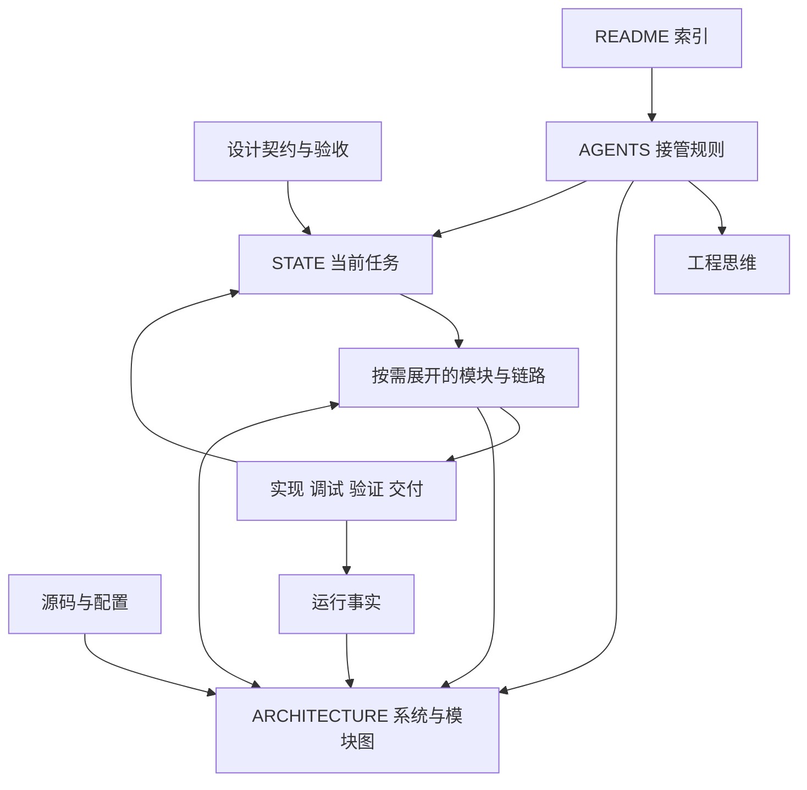

# 工程工作区入口

本页绑定实际知识位置。首次初始化时保留项目已有介绍和使用说明，将下表及接续入口整合到合适位置。当前任务与执行状态见 [STATE](STATE.md)，项目规则见 [AGENTS](AGENTS.md)。

| 资产 | 职责 |
| --- | --- |
| [工程思维](工程思维.md) | 全局与局部切换、语义追踪、复用与修复边界及用户规则 |
| [ARCHITECTURE](ARCHITECTURE.md) | 当前系统模型、系统图、主要模块及约束 |
| [STATE](STATE.md) | 当前契约、进展、实现差距与下一动作 |
| 设计来源 | 初始化时绑定 chat 中保留的关键契约、设计文档或 issue |
| 模块及链路 | 按需链接现有模块图、关键时序、状态与流程正文 |
| 开发及运维入口 | 绑定实际启动、构建、验证、PR、发布和恢复流程 |

图表示知识关系；实际系统图在 ARCHITECTURE 中。文件名按当地真实资产映射，同一判断由一个正式位置维护。
